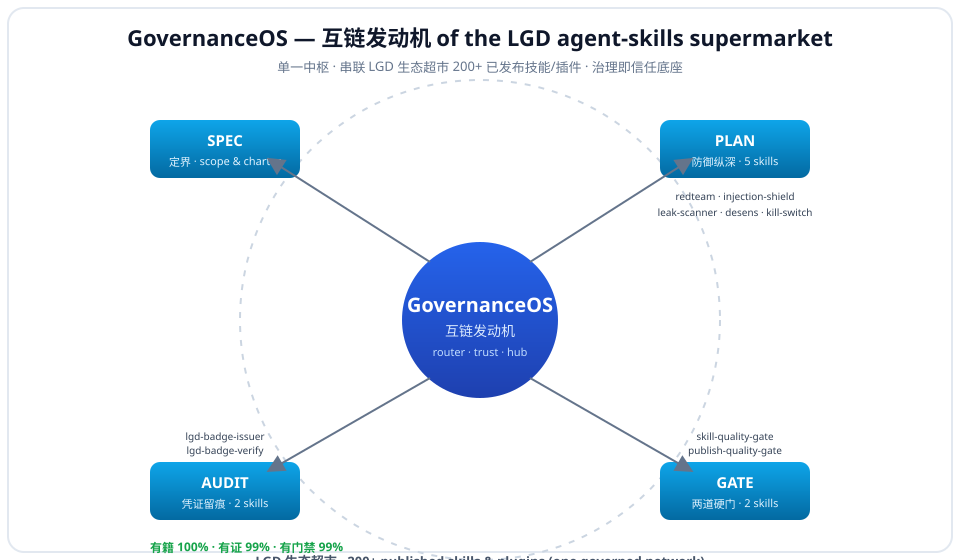

# GovernanceOS

> **The interlink engine and router of the LGD agent-skills supermarket — one command wires the full AI-agent governance lifecycle (SPEC → PLAN → GATE → AUDIT → EVO) and interconnects the 187-package LGD catalog (113 three-laws-governed; the other 74 are ecosystem listings not yet in the ledger) into one auditable network.**

[](#)
[](LICENSE)

**Install one command, get the whole governed network wired:**
```bash
openclaw plugins install clawhub:governanceos
```

---

## 🔥 The pain it kills (read this first)

You already trust your agent with prompts, files, and credentials. In production these go wrong — and after the **ClawHavoc** campaign ([ClawHub removed 2,400+ malicious / typosquatted skills that stole SSH keys, API tokens, cookies](https://parallelai.pro/articles/what-are-agent-skills)), the risks are no longer theoretical:

1. **Hijacked** — a prompt-injection hidden in an email, PDF, or webpage silently redirects your agent to exfiltrate data or run attacker commands.
2. **Leaky** — secrets, PII, or internal context slip into the agent's output or logs.
3. **Broken in prod** — a "skill" looks fine in the demo but fails, hallucinates, or ships unvetted to users.
4. **Supply-chain risk** — ClawHub has *no verified-publisher system*; near-miss typosquats of popular names install backdoors. You need a governed, auditable source.
5. **No map** — [67,000+ skills exist](https://parallelai.pro/articles/what-are-agent-skills) on the largest registry alone; you can't tell which are safe or governed.
6. **No audit trail** — after an incident there is no evidence of what was governed.
7. **Loose tools** — red-team, injection-shield, leak-scan live in separate places; nothing wires them into one lifecycle.
8. **No kill-switch** — when an agent goes off-script there is no pre-authorized emergency stop.
9. **Doc/code/log leakage** — sensitive internal paths or secrets leak when handed to an agent.
10. **Compliance gap** — teams shipping agents to production need a defensible governance routine, not a doc they forget.

**GovernanceOS addresses all ten** — and leaves a verifiable trail proving you did.

---

## ✅ Our advantages (why this, not the alternatives)

| # | Advantage | What it means for you |
|---|-----------|----------------------|
| 1 | **Single governed entry point** | Router of the LGD ecosystem supermarket (187-package catalog · 113 three-laws-governed; the other 74 are ecosystem listings not yet in the ledger). |
| 2 | **One command, whole lifecycle** | `openclaw plugins install clawhub:governanceos` wires SPEC → PLAN → GATE → AUDIT → EVO across 24 governance nodes. |
| 3 | **Defense-in-depth in PLAN** | redteam + injection-shield + leak-scanner + desens + kill-switch, in order. |
| 4 | **Eight hard gates** | quality / publish / admission / review / release-check / skill-release / human-oversight / gate-policy — block bad releases at every stage. |
| 5 | **Real provenance** | Badge issued *only* after gates pass, then verifiable (SHA-256). |
| 6 | **Three discovery-friendly meta hubs** | `lgd-gate` (8 gates), `lgd-audit` (10 auditors), `lgd-evo` (self-evolution) — thin pluggable dispatchers with honest `--verify` availability probes (LIVE / PRESENT / ECOSYSTEM). |
| 7 | **Evidence-linked, not hype** | Batch eval 7/9 executed, PASS ×7, **FAIL ×0**; LGD three-laws 有籍 100% / 有证 99% / 有门禁 99%. |
| 8 | **Theory + skills + evidence + charter in one unit** | LGD three-laws embedded, not bolted on. |
| 9 | **Cross-platform** | Claude / Codex / Cursor vendor shims included. |
| 10 | **Safe by design** | Read-only router: no network, no business-data writes. |
| 11 | **100% plain-text inspectable** | SKILL.md + scripts readable — "read before install". |
| 12 | **Free, MIT code** | Lower friction than paid suites. |

---

## 🗺️ The ecosystem map



*GovernanceOS routes to 24 governance nodes across SPEC→PLAN→GATE→AUDIT→EVO; three meta hubs (`lgd-gate`, `lgd-audit`, `lgd-evo`) aggregate each phase for discovery.*

```
   SPEC (定界)       PLAN (防御纵深)                GATE (八道硬门)                AUDIT (凭证留痕)           EVO (演化)
 ┌────────────┐  ┌──────────────────────┐  ┌──────────────────────────┐  ┌──────────────────────┐  ┌──────────────┐
 │ scope &    │─▶│ redteam → shield     │─▶│ quality · publish ·      │─▶│ badge-issuer/verify  │─▶│ agent-       │
 │ charter    │  │ → leak → desens      │  │ admission · review ·     │  │ three-laws · trace · │  │ evolution    │
 │            │  │ → kill-switch        │  │ release-check · skill-   │  │ bias · env · chain · │  │              │
 │            │  │                      │  │ release · oversight ·    │  │ trail · pkg · trace- │  │              │
 │            │  │                      │  │ policy (8 gates)         │  │ ability (10 auditors)│  │              │
 └────────────┘  └──────────────────────┘  └──────────────────────────┘  └──────────────────────┘  └──────────────┘
        \______________________ LGD three-laws embedded (theory + skills + evidence) ______________________/
```

---

## 👤 Who it's for

| You are… | GovernanceOS gives you |
|---|---|
| Building multi-agent / autonomous agents | Defense-in-depth layer + emergency kill-switch |
| Shipping internal skills/agents to a team | Eight hard gates before anything goes live |
| Needing an audit trail / compliance | Signed, verifiable badges + evidence chain |
| Browsing the LGD supermarket | One governed router interconnecting the 187-package catalog (113 three-laws-governed; the other 74 are ecosystem listings not yet in the ledger) |

---

## 📦 Install (pick one)

**Option A — ClawHub (recommended):**
```bash
openclaw plugins install clawhub:governanceos
```
**Option B — from source:**
```bash
git clone https://github.com/zhaoxinghua09-cell/governanceos
cd governanceos
./install.sh        # macOS / Linux
# or  ./install.ps1  # Windows (PowerShell)
```
The same repo installs across **Claude, Codex, and Cursor**.

> **Before installing any `<slug>`**, verify its fingerprint with `lgd-badge-verify` (or check the signed LGD registry). GovernanceOS is a router: it points at independently published packages and does not vouch for each one's publisher — the same supply-chain caution we warn about applies here too.

---

## ⚡ Router output (real output, not a mock)

*The router prints its real guidance from a pinned snapshot (2026-10-17); it does not execute the sub-skills itself.*

```bash
$ python3 scripts/governance_flow.py --list
GovernanceOS — lifecycle SPEC -> PLAN -> GATE -> AUDIT -> EVO (24 sub-skills, by slug):
[SPEC] SPEC
  - spec         -> (this suite)             | Scope + charter pinned; every later phase references it.
[PLAN] PLAN
  - redteam      -> agent-redteam-kit        | Drill report with scored attack surfaces and fix list.
  - shield       -> prompt-injection-shield  | Shield rules/guard decision for the given prompt.
  - leak         -> prompt-leak-scanner      | Leak findings list with line-level hints.
  - desens       -> doc-desens-scanner       | Desensitized copy + audit ledger of every mask.
  - killswitch   -> agent-kill-switch        | Kill card with stop conditions, revocation, owner, recovery.
[GATE] GATE
  - skill-gate   -> skill-quality-gate       | Quality gate verdict with blocking findings.
  - publish-gate -> publish-quality-gate     | Publish gate verdict; blocks launch on any blocking finding.
  - admission-gate -> skill-admission-gate     | Admission verdict: admit / conditional / reject with reasons.
  - review-gate  -> publish-review-gate      | Review verdict with checklist coverage.
  - release-gate -> release-gate-check       | Release readiness checklist with pass/fail.
  - skill-release-gate -> skill-release-gate       | Release gate verdict; blocks on blocking finding.
  - oversight-gate -> human-oversight-gate     | Oversight decision record with approver.
  - gate-policy  -> gate-policy-generator    | Generated gate policy document.
[AUDIT] AUDIT
  - badge-issue  -> lgd-badge-issuer         | Badge certificate with SHA-256 fingerprint + issuance ledger row.
  - badge-verify -> lgd-badge-verify         | Verify pass/fail with reasons.
  - three-laws   -> lgd-three-laws-auditor   | Three-laws audit verdict with per-law evidence.
  - trace-audit  -> agent-trace-audit        | Action trace log with anomaly flags.
  - bias-audit   -> bias-auditor             | Bias audit report with flagged dimensions.
  - env-audit    -> env-var-audit            | Env exposure report with leaked-secret findings.
  - gov-audit-chain -> ai-governance-audit-chain | Audit chain document linking every gate/evidence.
  - trail-keeper -> audit-trail-keeper       | Audit trail ledger with append-only entries.
  - pkg-compliance -> expert-package-compliance-audit | Compliance audit verdict with blocking findings.
  - traceability -> traceability-audit-team  | Traceability matrix with coverage gaps.
[EVO] EVO
  - evolution    -> agent-evolution          | Evolution log + refined operating procedure.

$ python3 scripts/governance_flow.py --badge
LGD three-laws (snapshot 2026-10-17T10:39:59+08:00):
  REGISTERED 有籍 : 113/113 packages · 100.0%
  EVIDENCED  有证 : 112/113 packages · 99.1%
  GATED      有门禁 : 112/113 packages · 99.1%
  embedded 24 sub-skills overall green: True
```

**Phase-level discovery hubs:** `lgd-gate` / `lgd-audit` / `lgd-evo` are thin meta-dispatchers. Run e.g. `lgd_gate.py --verify` for an honest per-node availability report (LIVE = script runs rc=0 · PRESENT = dir exists, doc-only · ECOSYSTEM = install the slug).

---

## 🛡️ The 24 interconnected governance nodes

| Stage | Skill (slug) | Protects against |
|-------|--------------|------------------|
| SPEC | _(this suite)_ | Pin scope & supervision charter |
| PLAN | `agent-redteam-kit` | Finds weakest injection path before attackers do |
| PLAN | `prompt-injection-shield` | Blocks injected instructions |
| PLAN | `prompt-leak-scanner` | Catches secrets/PII leaking into output |
| PLAN | `doc-desens-scanner` | Strips sensitive data from docs |
| PLAN | `agent-kill-switch` | Emergency stop when off-script |
| GATE | `skill-quality-gate` | Blocks unvetted skills from library admission |
| GATE | `publish-quality-gate` | Hard gate before shipping |
| GATE | `skill-admission-gate` | Admit/conditional/reject for new skills |
| GATE | `publish-review-gate` | Human + automated review before publish |
| GATE | `release-gate-check` | Release readiness checklist |
| GATE | `skill-release-gate` | Release gate for skill packages |
| GATE | `human-oversight-gate` | Human approval for high-risk actions |
| GATE | `gate-policy-generator` | Gate policy for new risk classes |
| AUDIT | `lgd-badge-issuer` | Signs verifiable badge (SHA-256) |
| AUDIT | `lgd-badge-verify` | Verifies badge provenance |
| AUDIT | `lgd-three-laws-auditor` | Three-laws audit (有籍/有证/有门禁) |
| AUDIT | `agent-trace-audit` | Post-incident action trace |
| AUDIT | `bias-auditor` | Bias audit before release |
| AUDIT | `env-var-audit` | Env/secrets exposure audit |
| AUDIT | `ai-governance-audit-chain` | Lifecycle governance audit chain |
| AUDIT | `audit-trail-keeper` | Immutable append-only audit trail |
| AUDIT | `expert-package-compliance-audit` | Publish-compliance audit |
| AUDIT | `traceability-audit-team` | Traceability matrix + coverage gaps |
| EVO | `agent-evolution` | Logs findings, refines playbook after deploy |

Each slug installs independently — `openclaw plugins install clawhub:<slug>`. The engine is a thin dispatcher: it only points at these slugs; it never vendors or runs their code.

---

## 🔬 Proof it works (measured, not claimed)

- **Batch evaluation:** 7/9 of the original launch nodes executed, **PASS ×7, FAIL ×0**; the engine now orchestrates 24 nodes.
- **Six self-gates pass:** YAML valid · `read_when` non-empty · bilingual complete · scripts runnable · desensitization 0 hits · rc=0.
- **LGD three-laws:** 有籍 100% · 有证 99% · 有门禁 99% across 113 packages.
- **Honest availability probes:** `lgd-gate --verify` → LIVE=4 · ECOSYSTEM=4; `lgd-audit --verify` → LIVE=6 · ECOSYSTEM=4; `lgd-evo --verify` → PRESENT=1 (measured on the working set snapshot; your machine may differ — run it yourself).

---

## 🌐 Standards alignment (for international readers)

GovernanceOS maps its lifecycle to the three reference frameworks the international community actually uses — **cited, not restated** (standard text stays with its publisher):

| Phase | What it does | ISO/IEC 42001:2023 | NIST AI RMF | OWASP |
|---|---|---|---|---|
| SPEC | pin scope + supervision charter | Cl. 5 Leadership | Govern | — |
| PLAN | red-team · injection-shield · leak-scan · desens · kill-switch | Cl. 6 Planning | Map / Measure / Manage | LLM Top 10 (2025): LLM01 Prompt Injection, LLM02 Sensitive Information Disclosure |
| GATE | 8 admission / publish / review / release gates | Cl. 9 Performance evaluation | Manage | — |
| AUDIT | badge · three-laws · trace · evidence chain | Cl. 9.2 Internal audit (+ 9.1 Monitoring) | Measure | — |
| EVO | self-evolution of the playbook | Cl. 10 Improvement | — (functions apply iteratively) | — |

- ISO/IEC 42001:2023 (AI management system) — https://www.iso.org/standard/81230.html
- NIST AI Risk Management Framework — https://www.nist.gov/itl/ai-risk-management-framework
- OWASP Top 10 for LLM Applications (2025) — https://owasp.org/www-project-top-10-for-large-language-model-applications/

This is the same alignment we apply when contributing to ITU / W3C / IETF (see our pre-publication review).

---

## ⚖️ GovernanceOS vs. "just install skills one by one"

| | Loose skills | GovernanceOS (hub) |
|---|---|---|
| Find safe skills | gamble on typosquats | one auditable LGD network (187-package catalog · 113 three-laws-governed) |
| Wire the lifecycle | manual, skippable | SPEC→PLAN→GATE→AUDIT→EVO enforced |
| Pre-launch audit | ad hoc | redteam + shield + leak + desens + kill-switch |
| Block bad releases | nothing | eight hard gates |
| Provenance | none | verifiable badge (SHA-256) |
| Inspectability | varies | 100% plain-text |

---

## 🔗 Borrowed external forces

- **ClawHub semantic search** — README / `llms.txt` / `llms-full.txt` tuned with trigger phrases.
- **LGD ecosystem inbound links** — every other LGD skill carries the footer snippet, turning the 187 catalog listings + ecosystem links into inbound traffic.
- **Registry front** — [lgd-skills-index](https://zhaoxinghua09-cell.github.io/lgd-skills-index/).
- **Shield arm — `wb-safe-team`** — pre-built safety agent team (8 sub-agents) is the runtime execution arm behind the PLAN shield stage.
- **Governance Council** — `governor-central` + `red-team-lead` + `security-supervisor` + `forensic-officer` + `quality-inspector` own the governance decisions behind the gates.
- **Multi-channel** — SkillHub, ModelScope, BuiltinMarket under the LGD org.

### Footer snippet for other LGD skills (interlink)
```markdown
> Part of the [LGD agent-skills supermarket](https://zhaoxinghua09-cell.github.io/lgd-skills-index/),
> governed by [GovernanceOS](https://clawhub.ai/zhaoxinghua09-cell/plugins/governanceos) (SPEC→PLAN→GATE→AUDIT→EVO).
```

---

## ❓ FAQ

**Do I need all 24 nodes?** No — the engine routes you; install only the slugs you need. Each node is an independent package.
**Is it just docs?** No — the router runs and prints real guidance; every sub-skill is a working package.
**Does it touch my data?** No — the router is read-only, no network, no business-data writes (the router only; each sub-skill runs under its own SKILL.md permissions).
**Claude / Codex / Cursor?** Yes — vendor shims included.

---

## 📄 License

- **Code (MIT):** `scripts/governance_flow.py`, installers, plugin shims — see [LICENSE](LICENSE).
- **Methodology text (All Rights Reserved):** `SKILL.md`, `README.md` — short quote + link with attribution fine; reprint/adapt/training-use needs written permission — see [LICENSE-CONTENT](LICENSE-CONTENT).

Security: [SECURITY.md](SECURITY.md). Contributions: [CONTRIBUTING.md](CONTRIBUTING.md).
Contact: zhaoxinghua09@gmail.com ｜ ORCID 0009-0001-0512-1237
