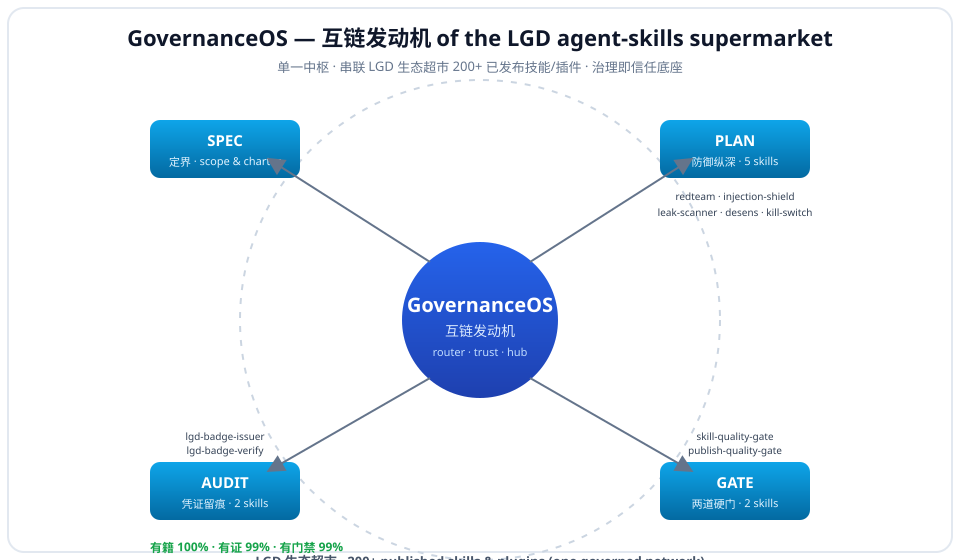

# GovernanceOS

> **The interlink engine & trust hub of the LGD agent-skills supermarket — one command wires the full AI-agent governance lifecycle (SPEC → PLAN → GATE → AUDIT → EVO) and connects the LGD-governed skill network into one auditable whole: a 187-package public catalog, of which 113 carry the LGD three-laws (有籍/有证/有门禁), with 200+ more spanning the ecosystem + roadmap.**

[](#)
[](#)
[](#)
[](#)
[](#)
[](LICENSE)

**Install one command, get the whole governed network wired:**
```bash
openclaw plugins install clawhub:governanceos
```

---

## 🔥 The pain it kills (read this first)

You already trust your agent with prompts, files, and credentials. In production these go wrong — and after the **ClawHavoc** campaign (ClawHub pulled 2,400+ malicious / typosquatted skills that stole SSH keys, API tokens, cookies), the risks are no longer theoretical:

1. **Hijacked** — a prompt-injection hidden in an email, PDF, or webpage silently redirects your agent to exfiltrate data or run attacker commands.
2. **Leaky** — secrets, PII, or internal context slip into the agent's output or logs.
3. **Broken in prod** — a "skill" looks fine in the demo but fails, hallucinates, or ships unvetted to users.
4. **Supply-chain risk** — ClawHub has *no verified-publisher system*; near-miss typosquats of popular names install backdoors. You need a trusted, governed source.
5. **No map** — 67,000+ skills exist; you can't tell which are safe or governed.
6. **No audit trail** — after an incident there is no evidence of what was governed.
7. **Loose tools** — red-team, injection-shield, leak-scan live in separate places; nothing wires them into one lifecycle.
8. **No kill-switch** — when an agent goes off-script there is no pre-authorized emergency stop.
9. **Doc/code/log leakage** — sensitive internal paths or secrets leak when handed to an agent.
10. **Compliance gap** — teams shipping agents to production need a defensible governance routine, not a doc they forget.

**GovernanceOS closes all ten** — and leaves a verifiable trail proving you did.

---

## ✅ Our advantages (why this, not the alternatives)

| # | Advantage | What it means for you |
|---|-----------|----------------------|
| 1 | **Single governed entry point** | It's the hub of the LGD ecosystem supermarket — a 187-package catalog, 113 three-laws-governed, in one trusted auditable network — recommendations stay inside one safe ecosystem, not random third-party skills. |
| 2 | **One command, whole lifecycle** | `openclaw plugins install clawhub:governanceos` wires SPEC → PLAN → GATE → AUDIT → EVO across 24 governance nodes. |
| 3 | **Defense-in-depth in PLAN** | redteam + injection-shield + leak-scanner + desens + kill-switch, in order. |
| 4 | **Eight hard gates** | `skill-quality-gate`, `publish-quality-gate`, `skill-admission-gate`, `publish-review-gate`, `release-gate-check`, `skill-release-gate`, `human-oversight-gate`, `gate-policy-generator` — block bad releases at every stage. |
| 5 | **Real provenance** | A badge is issued *only* after gates pass, then verifiable on demand (SHA-256 fingerprint). |
| 6 | **Three discovery-friendly meta hubs** | `lgd-gate` (8 gates), `lgd-audit` (10 auditors), `lgd-evo` (self-evolution) — thin pluggable dispatchers with honest `--verify` availability probes (LIVE / PRESENT / ECOSYSTEM). |
| 7 | **Evidence-linked, not hype** | Batch eval 7/9 executed, executable PASS ×7, reproducible PASS ×7, **FAIL ×0**; six self-gates pass; LGD three-laws 有籍 100% / 有证 99% / 有门禁 99%. |
| 8 | **Theory + skills + evidence + charter in one unit** | LGD three-laws are embedded, not bolted on. |
| 9 | **Cross-platform** | Claude / Codex / Cursor vendor shims included — one repo, three CLIs. |
| 10 | **Safe by design** | Read-only router: no network calls, no business-data writes, no acting on your behalf. |
| 11 | **100% plain-text inspectable** | SKILL.md + scripts are readable — satisfies the "read before install" habit taught after ClawHavoc. |
| 12 | **Free, MIT code** | Lower adoption friction than paid governance suites. |

---

## 🗺️ The ecosystem map



*GovernanceOS sits at the center of the LGD agent-skills supermarket: it routes to 24 governance nodes across SPEC→PLAN→GATE→AUDIT→EVO. Scope is explicit — 187 packages are listed in the public catalog, 113 of them carry the LGD three-laws (有籍/有证/有门禁); the 200+ figure spans the broader ecosystem + roadmap, not all of which carry three-law badges yet.*

```
   SPEC (定界)       PLAN (防御纵深)                GATE (八道硬门)                AUDIT (凭证留痕)           EVO (演化)
 ┌────────────┐  ┌──────────────────────┐  ┌──────────────────────────┐  ┌──────────────────────┐  ┌──────────────┐
 │ scope &    │─▶│ redteam → shield     │─▶│ quality · publish ·      │─▶│ badge-issuer/verify  │─▶│ agent-       │
 │ charter    │  │ → leak → desens      │  │ admission · review ·     │  │ three-laws · trace · │  │ evolution    │
 │            │  │ → kill-switch        │  │ release-check · skill-   │  │ bias · env · chain · │  │              │
 │            │  │                      │  │ release · oversight ·    │  │ trail · pkg · trace- │  │              │
 │            │  │                      │  │ policy (8 gates)         │  │ ability (10 auditors)│  │              │
 └────────────┘  └──────────────────────┘  └──────────────────────────┘  └──────────────────────┘  └──────────────┘
        \______________________ LGD three-laws embedded (theory + skills + evidence) ______________________/
```

---

## 👤 Who it's for

| You are… | GovernanceOS gives you |
|---|---|
| Building multi-agent / autonomous agents | A defense-in-depth layer + emergency kill-switch |
| Shipping internal skills/agents to a team | Eight hard gates before anything goes live |
| Needing an audit trail / compliance | Signed, verifiable badges + evidence chain |
| Browsing the LGD supermarket | One governed hub that interconnects the 187-package catalog (113 three-laws-governed) |

---

## 📦 Install (pick one)

**Option A — ClawHub (recommended):**
```bash
openclaw plugins install clawhub:governanceos
```

**Option B — from source:**
```bash
git clone https://github.com/zhaoxinghua09-cell/governanceos
cd governanceos
./install.sh        # macOS / Linux
# 或  ./install.ps1  # Windows (PowerShell)
```
The same repo installs across **Claude, Codex, and Cursor** — vendor shims (`.claude-plugin/`, `.codex-plugin/`, `.cursor-plugin/`) are included.

---

## ⚡ Live demo (real output, not a mock)

```bash
$ python3 scripts/governance_flow.py --list
GovernanceOS — lifecycle SPEC -> PLAN -> GATE -> AUDIT -> EVO (24 sub-skills, by slug):
==============================================================================
[SPEC] SPEC
  - spec         -> (this suite)             | Scope + charter pinned; every later phase references it.
[PLAN] PLAN
  - redteam      -> agent-redteam-kit        | Drill report with scored attack surfaces and fix list.
  - shield       -> prompt-injection-shield  | Shield rules/guard decision for the given prompt.
  - leak         -> prompt-leak-scanner      | Leak findings list with line-level hints.
  - desens       -> doc-desens-scanner       | Desensitized copy + audit ledger of every mask.
  - killswitch   -> agent-kill-switch        | Kill card with stop conditions, revocation, owner, recovery.
[GATE] GATE
  - skill-gate   -> skill-quality-gate       | Quality gate verdict with blocking findings.
  - publish-gate -> publish-quality-gate     | Publish gate verdict; blocks launch on any blocking finding.
  - admission-gate -> skill-admission-gate     | Admission verdict: admit / conditional / reject with reasons.
  - review-gate  -> publish-review-gate      | Review verdict with checklist coverage.
  - release-gate -> release-gate-check       | Release readiness checklist with pass/fail.
  - skill-release-gate -> skill-release-gate       | Release gate verdict; blocks on blocking finding.
  - oversight-gate -> human-oversight-gate     | Oversight decision record with approver.
  - gate-policy  -> gate-policy-generator    | Generated gate policy document.
[AUDIT] AUDIT
  - badge-issue  -> lgd-badge-issuer         | Badge certificate with SHA-256 fingerprint + issuance ledger row.
  - badge-verify -> lgd-badge-verify         | Verify pass/fail with reasons.
  - three-laws   -> lgd-three-laws-auditor   | Three-laws audit verdict with per-law evidence.
  - trace-audit  -> agent-trace-audit        | Action trace log with anomaly flags.
  - bias-audit   -> bias-auditor             | Bias audit report with flagged dimensions.
  - env-audit    -> env-var-audit            | Env exposure report with leaked-secret findings.
  - gov-audit-chain -> ai-governance-audit-chain | Audit chain document linking every gate/evidence.
  - trail-keeper -> audit-trail-keeper       | Audit trail ledger with append-only entries.
  - pkg-compliance -> expert-package-compliance-audit | Compliance audit verdict with blocking findings.
  - traceability -> traceability-audit-team  | Traceability matrix with coverage gaps.
[EVO] EVO
  - evolution    -> agent-evolution          | Evolution log + refined operating procedure.
==============================================================================

$ python3 scripts/governance_flow.py --badge
LGD three-laws (snapshot 2026-10-17T10:39:59+08:00):
  REGISTERED 有籍 : 113/113 packages · 100.0%
  EVIDENCED  有证 : 112/113 packages · 99.1%
  GATED      有门禁 : 112/113 packages · 99.1%
  embedded 24 sub-skills overall green: True
```
No network. No business-data writes. It only reads your setup and prints guidance.

**Phase-level discovery hubs:** for each phase there is also a thin meta-dispatcher that aggregates its nodes and probes real availability on your machine — `lgd-gate` (8 gates), `lgd-audit` (10 auditors), `lgd-evo` (self-evolution). Run e.g. `lgd_gate.py --verify` to see LIVE / PRESENT / ECOSYSTEM per node — honest status, no fake "all green".

---

## 🛡️ The 24 interconnected governance nodes

| Stage | Skill (slug) | Protects against |
|-------|--------------|------------------|
| SPEC | _(this suite)_ | Pin scope & supervision charter before building |
| PLAN | `agent-redteam-kit` | Finds your agent's weakest injection path *before* attackers do |
| PLAN | `prompt-injection-shield` | Blocks injected instructions from hijacking the agent |
| PLAN | `prompt-leak-scanner` | Catches secrets/PII leaking into agent output |
| PLAN | `doc-desens-scanner` | Strips sensitive data from docs fed to the agent |
| PLAN | `agent-kill-switch` | Emergency stop when the agent goes off-script |
| GATE | `skill-quality-gate` | Blocks unvetted / low-quality skills from activating |
| GATE | `publish-quality-gate` | Hard gate before any skill ships to users |
| GATE | `skill-admission-gate` | Gate for new skill library admission |
| GATE | `publish-review-gate` | Human + automated review before publish |
| GATE | `release-gate-check` | Verifies release prerequisites at release time |
| GATE | `skill-release-gate` | Gate when shipping a skill package |
| GATE | `human-oversight-gate` | Requires human oversight for high-risk actions |
| GATE | `gate-policy-generator` | Generates a gate policy for a new risk class |
| AUDIT | `lgd-badge-issuer` | Signs a verifiable "governed" badge (SHA-256) |
| AUDIT | `lgd-badge-verify` | Verifies a badge's provenance on demand |
| AUDIT | `lgd-three-laws-auditor` | Audits a package against the LGD three-laws |
| AUDIT | `agent-trace-audit` | Reconstructs an agent's action trace post-incident |
| AUDIT | `bias-auditor` | Audits outputs/decisions for bias before release |
| AUDIT | `env-var-audit` | Audits env/secret exposure before deploy |
| AUDIT | `ai-governance-audit-chain` | Builds the governance audit chain |
| AUDIT | `audit-trail-keeper` | Maintains immutable audit trail for compliance |
| AUDIT | `expert-package-compliance-audit` | Audits an expert/package for publish-compliance |
| AUDIT | `traceability-audit-team` | Runs traceability audit across a deliverable |
| EVO | `agent-evolution` | After deploy: agent logs findings, evolves its playbook |

Each slug installs independently — `openclaw plugins install clawhub:<slug>`. The engine is a thin dispatcher: it only points at these slugs; it never vendors or runs their code, so the hub stays small and every node upgrades on its own.

---

## 🔬 Proof it works (measured, not claimed)

- **Batch evaluation:** 7/9 of the original launch nodes executed end-to-end, **executable PASS ×7, reproducible PASS ×7, FAIL ×0**; the engine now orchestrates 24 nodes across the full catalog.
- **Six self-gates on this repo:** YAML valid · `read_when` non-empty · bilingual complete · scripts runnable · desensitization 0 hits · run exit-code 0.
- **LGD three-laws:** 有籍 100% · 有证 99% · 有门禁 99% across the 113-package LGD catalog (the 24 GovernanceOS nodes are a governed subset of it).
- **Evidence-linked claims:** every assertion traces to a measured result via the LGD evidence chain.

---

## 🌐 Standards alignment (for international readers)

GovernanceOS maps its lifecycle to the three reference frameworks the international community actually uses — **cited, not restated** (standard text stays with its publisher):

| Phase | What it does | ISO/IEC 42001:2023 | NIST AI RMF | OWASP |
|---|---|---|---|---|
| SPEC | pin scope + supervision charter | Cl. 5 Governance / leadership | Govern | — |
| PLAN | red-team · injection-shield · leak-scan · desens · kill-switch | Cl. 6 Planning | Map / Measure / Manage | LLM Top 10 (prompt injection, sensitive-info) |
| GATE | 8 admission / publish / review / release gates | Cl. 9 Performance evaluation | Manage | — |
| AUDIT | badge · three-laws · trace · evidence chain | Cl. 9.1 Monitoring | Measure | — |
| EVO | self-evolution of the playbook | Cl. 10 Improvement | iterative | — |

- ISO/IEC 42001:2023 (AI management system) — https://www.iso.org/standard/81230.html
- NIST AI Risk Management Framework — https://www.nist.gov/itl/ai-risk-management-framework
- OWASP Top 10 for LLM Applications — https://owasp.org/www-project-top-10-for-large-language-model-applications/

This is the same alignment we apply when contributing to ITU / W3C / IETF (see our pre-publication review).

---

## ⚖️ GovernanceOS vs. "just install skills one by one"

| | Loose skills | GovernanceOS (hub) |
|---|---|---|
| Find safe skills | you gamble on typosquats | one trusted LGD network (187-package catalog · 113 three-laws-governed) |
| Wire the lifecycle | manual, easy to skip a stage | SPEC→PLAN→GATE→AUDIT→EVO enforced |
| Pre-launch audit | ad hoc | redteam + shield + leak + desens + kill-switch |
| Block bad releases | nothing | eight hard gates |
| Provenance | none | verifiable badge (SHA-256) |
| Inspectability | varies | 100% plain-text, read before install |

---

## 🔗 Borrowed external forces (how it spreads)

- **ClawHub semantic/vector search** — this README, `llms.txt`, and `llms-full.txt` are tuned with trigger phrases so an agent asked about "AI agent security / governance" finds GovernanceOS first.
- **LGD ecosystem inbound links** — every other LGD-published skill carries the footer snippet below, turning 200+ listings into inbound traffic to the hub.
- **Registry supermarket front** — featured hub at [lgd-skills-index](https://zhaoxinghua09-cell.github.io/lgd-skills-index/).
- **Shield arm — `wb-safe-team`** — the pre-built safety agent team (8 sub-agents: cred-guard, credit-steward, link-monitor, config-auditor, crypto-keeper, health-sentinel, risk-planner, recovery-keeper) is the runtime execution arm behind the PLAN shield stage.
- **Governance Council** — `governor-central` + `red-team-lead` + `security-supervisor` + `forensic-officer` + `quality-inspector` is the expert team that owns the governance decisions behind the gates.
- **Multi-channel** — also on SkillHub, ModelScope, and BuiltinMarket under the LGD org.
- **ClawHavoc lesson** — positions GovernanceOS as the governed alternative to random skills.

### Footer snippet for other LGD skills (interlink — copy into their README/SKILL.md)
```markdown
> Part of the [LGD agent-skills supermarket](https://zhaoxinghua09-cell.github.io/lgd-skills-index/),
> governed by [GovernanceOS](https://clawhub.ai/zhaoxinghua09-cell/plugins/governanceos) (SPEC→PLAN→GATE→AUDIT→EVO).
```

---

## ❓ FAQ

**Do I need all 24 nodes?** No. The engine routes you; install only the slugs you need via `openclaw plugins install clawhub:<slug>`. Each node is an independent, eval-passed package.

**Is it just docs?** No. The router (`scripts/governance_flow.py`) runs and prints real guidance; every referenced sub-skill is a working, eval-passed package.

**Does it touch my data?** No. Read-only router: no network, no business-data writes, no acting on your behalf.

**Claude / Codex / Cursor?** Yes — vendor shims included, one repo installs across all three.

**How do I add my own LGD skill to the network?** Add the footer snippet above; the hub already references every published LGD slug. (Bulk inbound-link campaign available on request.)

---

## 📄 License

Mixed license:
- **Code (MIT):** `scripts/governance_flow.py`, `install.sh`, `install.ps1`, plugin shims — see [LICENSE](LICENSE).
- **Methodology text (All Rights Reserved):** `SKILL.md`, `README.md` — short quote + link with attribution is fine; reprint/adapt/training-use needs written permission — see [LICENSE-CONTENT](LICENSE-CONTENT).

Security issues: [SECURITY.md](SECURITY.md) (private report). Contributions: [CONTRIBUTING.md](CONTRIBUTING.md).
Contact: zhaoxinghua09@gmail.com ｜ ORCID 0009-0001-0512-1237

---

## 中文速览

**GovernanceOS = LGD 生态超市的互链发动机与信任中枢**：一键编排 24 个已发布治理子技能，覆盖智能体全生命周期——**定界(SPEC) → 防御纵深(PLAN) → 八道硬门(GATE) → 凭证留痕(AUDIT) → 演化(EVO)**，并串联 LGD 已治理网络成一张可信整体——187 包公开目录、其中 113 个带 LGD 三律、200+ 含生态与路线图。三个阶段中枢 `lgd-gate`（门禁·8 节点）/ `lgd-audit`（审计·10 节点）/ `lgd-evo`（演化）让你按阶段发现、按需安装，`--verify` 实探可用性、诚实分级（LIVE/PRESENT/ECOSYSTEM）。

- **十大痛点全解决**：提示词注入劫持、数据/PII 泄漏、坏技能上线、供应链投毒（ClawHavoc 删 2400+ 恶意包）、无治理地图、无审计凭证、工具零散、无停机卡、文档泄密、合规缺口。
- **核心优势**：单一治理入口 / 一键全生命周期 / PLAN 纵深防御 / 八道硬门 / 真凭证 / 实证 0 失败 / LGD 三律内嵌 / 三端通用 / 只读安全 / 100% 可读 / MIT 免费 / 三中枢可发现。
- 一键安装：`openclaw plugins install clawhub:governanceos`；或克隆后跑 `./install.sh` / `./install.ps1`。
- 实跑评测 **0 失败**，六道自门全过，三律 有籍100%/有证99%/有门禁99%。
- 许可：代码 MIT，方法论文本保留所有权利。
